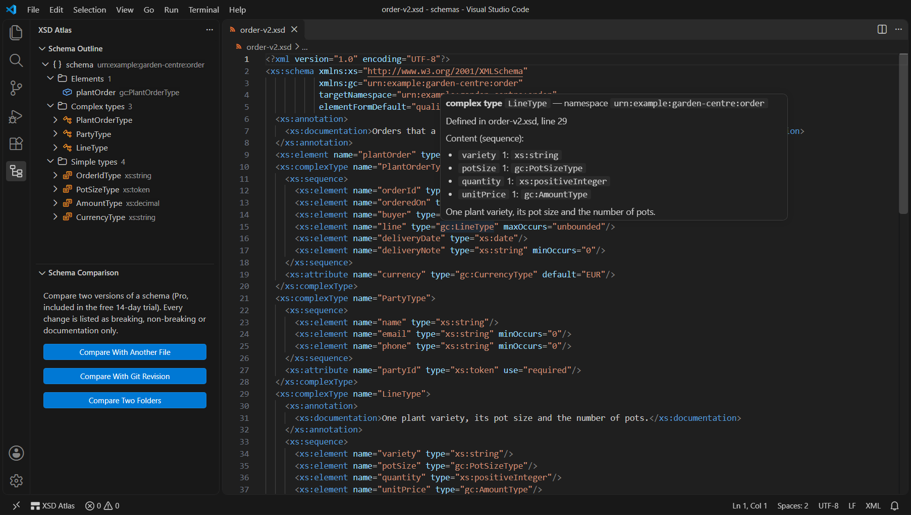
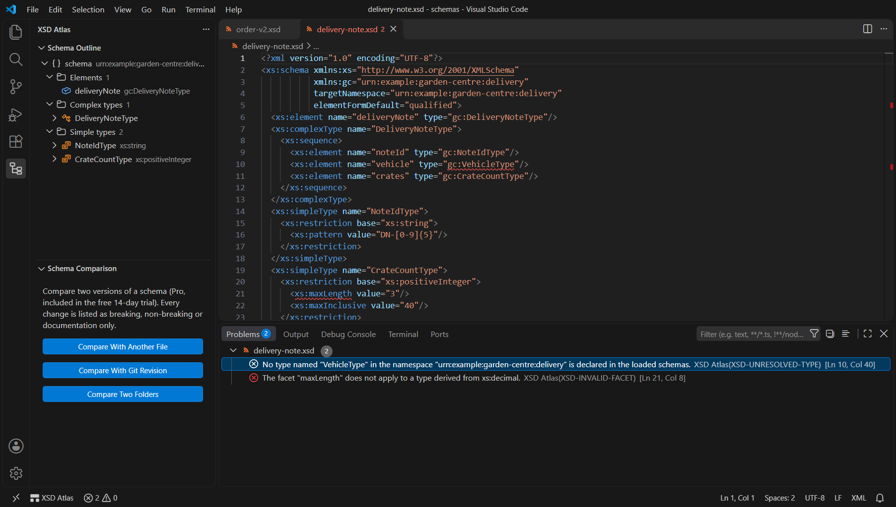
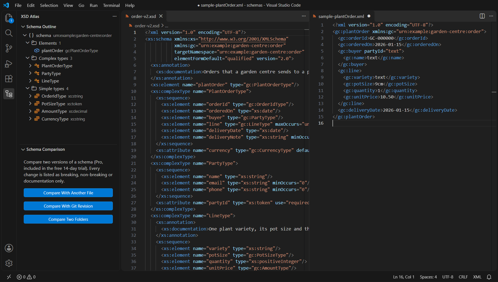
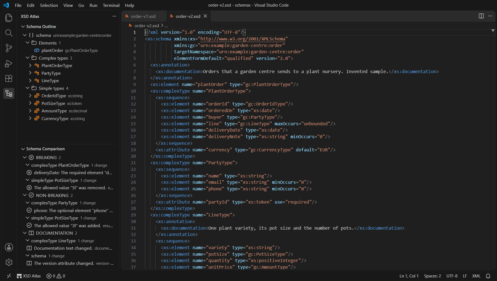
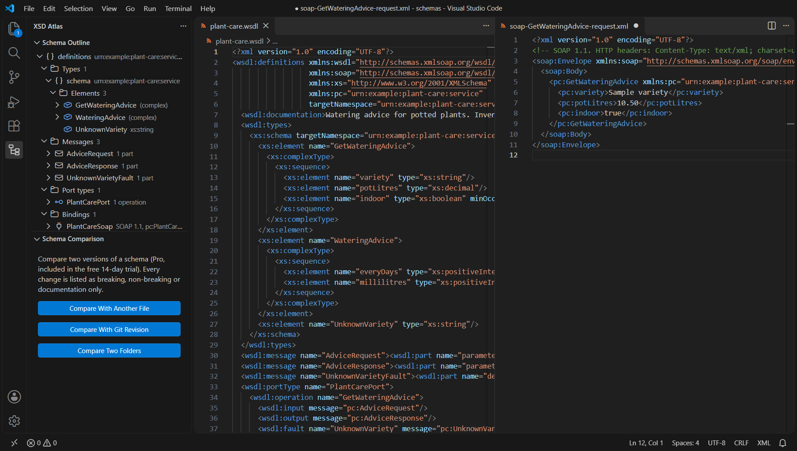

# XSD Atlas

**Find your way through XML Schema (XSD) and WSDL files in VS Code.** See the structure of a schema set at a glance, jump from any type or element reference to its definition across imports and includes, read every facet and documentation line in a hover, catch broken references before a partner does, and build a sample XML document for any element. **Pro** compares two schema versions and classifies every change as breaking, non-breaking or documentation only (with the limits stated in the comparison rules), and writes documentation, flattened schemas, SOAP envelope samples and a workspace inventory.

Made for integration engineers who live with SOAP services and XML message schemas: B2B orders and invoices, bank and public-sector interfaces, internal service contracts. Everything runs on your computer, with no telemetry and no account.

## Screenshots

The Schema Outline and a hover with the resolved definition:

Problems with stable codes, found across included and imported files:

A sample XML document built from the schema:

Schema comparison (Pro), every change classified:

SOAP envelope sample for a WSDL operation (Pro):

## Free, trial and Pro

| Feature | Free | Trial (14 days) | Pro |
| --- | :---: | :---: | :---: |
| Schema Outline view, Outline view and breadcrumbs for XSD and WSDL 1.1 / 2.0 | yes | yes | yes |
| Hover: definition, base types, facets, content, attributes, occurrence, documentation | yes | yes | yes |
| Go to definition and find references across include, import, redefine and the workspace | yes | yes | yes |
| Path of the declaration at the cursor (status bar, Copy Path At Cursor) | yes | yes | yes |
| Problems with stable codes (references, names, namespaces, derivation, facets, files, WSDL) | yes | yes | yes |
| Create Sample XML (minimal, facet-aware) | yes | yes | yes |
| Walkthrough, sample files, Report A Problem | yes | yes | yes |
| Compare two files, two folders or a git revision, with BREAKING / NON-BREAKING / DOCUMENTATION classes | | yes | yes |
| Comparison report as Markdown, HTML or CSV | | yes | yes |
| Create Full Sample XML (optional parts, repeats, choice strategy, realistic values, seed) | | yes | yes |
| Schema documentation (Markdown, HTML, type index) | | yes | yes |
| Flatten Schema (includes merged, one file per namespace) | | yes | yes |
| SOAP 1.1 / 1.2 request, response and fault envelope samples | | yes | yes |
| Workspace schema inventory (who imports whom, missing files, unused types) | | yes | yes |

* **Free** needs no key, no account and no network connection, for personal and commercial use. Free features will not be moved behind the key later.
* **Trial**: the first Pro command you run starts a free 14-day trial of every Pro feature on this computer. It is recorded only in the editor's storage on this computer (nothing is sent anywhere) and needs no key or account. **XSD Atlas: Show Licence Status** shows the days left.
* **Pro** is a one-time purchase, not a subscription: **Pro Personal USD 29** (one person, up to 3 computers, use at work allowed) or **Pro Business USD 59 per user** (for organisations; one key per user, each for up to 3 computers). Prices at the time of writing; the checkout page shows the final price and any taxes for your country. **XSD Atlas: Buy Pro** opens the checkout, the key arrives by e-mail, **XSD Atlas: Enter Licence Key** activates it. Pro is sold outside the Visual Studio Marketplace.

## Quick start

1. Install **XSD Atlas** from the Extensions view (publisher Small Steps Studio). Built for VS Code 1.82 or newer; tested with VS Code 1.146 on Windows.
2. Open an `.xsd` or `.wsdl` file, or run **XSD Atlas: Open Sample Schema** for an invented sample.
3. Click the XSD Atlas icon in the activity bar for the **Schema Outline**; rest the pointer on a type name for its definition.
4. F12 on a reference opens its definition, Shift+F12 lists every use; the status bar shows the path at the cursor.
5. **XSD Atlas: Create Sample XML** builds a sample document for an element.
6. **Help > Welcome > Get started with XSD Atlas** walks through the rest in five steps.

More: [Getting started](docs/getting-started.md), [Problems and codes](docs/problems.md), [Comparison rules](docs/diff-rules.md), [Sample XML](docs/samples.md), [WSDL](docs/wsdl.md), [Licence, trial and Pro](docs/licence.md), [Troubleshooting](docs/troubleshooting.md), [Changelog](CHANGELOG.md).

## Features in detail

### Schema Outline, symbols and breadcrumbs

For an XSD file: imports and includes (with their state: loaded, file not found, remote location not loaded), elements, complex types, simple types, attributes, groups, attribute groups, notations, substitution groups and identity constraints. Each entry shows its type or base type; expand it to see the declared sequence, choice and all compositors, local elements with occurrence, attributes, derivations and facets. Documentation appears as a tooltip.

For a WSDL file: imports, the embedded schemas (each with the outline above), messages and parts, port types or interfaces with operations, bindings with SOAP version and actions, services with ports or endpoints and addresses.

The same tree feeds the editor's Outline view and breadcrumbs.

### Hover

On a reference (`type`, `ref`, `base`, `itemType`, `memberTypes`, `substitutionGroup`, `refer`, and in WSDL `element`, `type`, `message`, `binding`, `interface`) or on a declaration name: the kind and namespace, the file and line, the chain of base types, the effective facets (enumerations, patterns, lengths, bounds, digits, white space), the child elements with occurrence and type, the attributes with use and default, substitution group members and the documentation.

### Go to definition and find references

References are resolved through the namespace declarations in scope, following include, import, redefine and override (and chameleon includes) through relative paths. If a name is not found in the loaded set, the schema files of the workspace are searched. Find references searches the loaded set and every schema file of the workspace (settings `xsdAtlas.workspace.include`, `xsdAtlas.workspace.exclude`, `xsdAtlas.workspace.maxFiles`). F12 on a `schemaLocation` opens that file.

### Path at the cursor

The status bar shows where the declaration at the cursor sits in a document: `/plantOrder/line/quantity`, `/plantOrder/@currency`, or `LineType: unitPrice` inside a named type. Click it or run **XSD Atlas: Copy Path At Cursor** to copy it.

### Problems

Common structural checks with stable codes: unresolved types, elements, attributes, groups and keys; undeclared prefixes; namespaces used without import; duplicate names; circular derivation, groups and substitution groups; invalid facets (a facet that does not apply, a contradictory or loosening value, an invalid pattern, an enumeration value the base type rejects); invalid default and fixed values; invalid minOccurs/maxOccurs; schemaLocation files that do not exist; imports that cannot be loaded; targetNamespace mismatches; and the WSDL reference checks. The complete list is in [docs/problems.md](docs/problems.md). These checks look at the schema itself; XSD Atlas does not validate XML documents against a schema.

### Create Sample XML

A minimal document for a global element: every required element as often as minOccurs asks, required attributes, the first option of each choice, default and fixed values, and values that satisfy the facets of their type (a note in the sample says where that was not possible). Abstract elements and types are replaced by concrete ones. Details in [docs/samples.md](docs/samples.md).

### Schema comparison (Pro)

**Compare Schema With Another File** (the active editor is the new version), **Compare Two Schema Folders** and **Compare With Git Revision** (through the built-in Git extension; the working copy is the new version). Both versions are loaded with everything they include and import, and every change is classified:

* **BREAKING**: a document that is valid under the old version can be invalid under the new one, or reads differently (removed or reordered elements, new required elements, narrowed facets, removed enumeration values, optional to required, type changes, namespace changes, changed defaults);
* **NON-BREAKING**: old documents stay valid (new optional elements, widened facets, new enumeration values, required to optional);
* **DOCUMENTATION**: annotations and version text only.

Content is compared in its effective form, so moving declarations into a group or a base type is not reported as a change, and a change inside a shared group is reported once. Requirement changes inside optional groups and choice branches are reported as well, and the order, names and counts of the child elements of each content are checked as a whole. The comparison errs on the safe side and has stated limits (patterns, type changes and very large contents are classified conservatively); when the check of a very large content cannot be completed it reports the change as breaking rather than as nothing; a NON-BREAKING verdict is a statement about the schema structure, not a guarantee for your documents. The rules for every one of the 91 change codes are in [docs/diff-rules.md](docs/diff-rules.md). The result appears in the **Schema Comparison** view (click a change to open it) and **Export Comparison Report** writes Markdown, HTML or CSV.

### Create Full Sample XML (Pro)

All optional parts, repeated elements (`xsdAtlas.sample.repeat`), a choice strategy (first, rotate, pick each, random), realistic values chosen by element and attribute names when they satisfy the facets (`xsdAtlas.sample.realisticValues`), and a seed (`xsdAtlas.sample.seed`) for repeatable output.

### Create Schema Documentation (Pro)

A Markdown or HTML reference of the loaded schema set: per namespace, every element, type, group and attribute group with its documentation, content table, attributes, facets and "used by" list, plus an alphabetical type index. The HTML is one self-contained page without scripts.

### Flatten Schema (Pro)

Merges a schema and everything it includes into one schema document per target namespace: QName references (also QName values such as defaults and enumeration values) are rewritten to one set of prefixes, chameleon includes take their namespace, and local declarations get an explicit `form` where the merged files disagreed. One XSD document can hold only one target namespace, so imported namespaces become further files linked by relative schemaLocation; the file of the main namespace imports every other file that is written, also when no reference uses it. Sets that use xs:redefine or xs:override are refused, because merging them would change their meaning. Files are written only after you confirm.

### Create SOAP Envelope Samples (Pro)

For an operation of a SOAP 1.1 or SOAP 1.2 binding (WSDL 1.1 or 2.0): the request with headers, the response and one envelope per fault, in document or rpc style, with the SOAPAction or action noted in a comment. Built locally; nothing is sent. Details in [docs/wsdl.md](docs/wsdl.md).

### Create Workspace Schema Inventory (Pro)

Every XSD and WSDL file of the workspace with its kind, namespace, version and component counts; includes and imports with their state; who imports whom; missing files; namespaces declared by several files; global types that no scanned file refers to. As Markdown, HTML or CSV.

## Commands

| Command | Tier |
| --- | :---: |
| XSD Atlas: Check Current File | Free |
| XSD Atlas: Copy Path At Cursor | Free |
| XSD Atlas: Create Sample XML | Free |
| XSD Atlas: Open Sample Schema / Open Sample Schema Version 2 / Open Sample WSDL | Free |
| XSD Atlas: Open Getting Started Guide | Free |
| XSD Atlas: Show Documentation | Free |
| XSD Atlas: Report A Problem | Free |
| XSD Atlas: Clear Comparison | Free |
| XSD Atlas: Buy Pro | Free |
| XSD Atlas: Enter Licence Key | Free |
| XSD Atlas: Show Licence Status | Free |
| XSD Atlas: Remove Licence From This Machine | Free |
| XSD Atlas: Compare Schema With Another File | Pro |
| XSD Atlas: Compare Two Schema Folders | Pro |
| XSD Atlas: Compare With Git Revision | Pro |
| XSD Atlas: Export Comparison Report | Pro |
| XSD Atlas: Create Full Sample XML | Pro |
| XSD Atlas: Create Schema Documentation | Pro |
| XSD Atlas: Flatten Schema | Pro |
| XSD Atlas: Create SOAP Envelope Samples | Pro |
| XSD Atlas: Create Workspace Schema Inventory | Pro |

The editor context menu of `.xsd` and `.wsdl` files has an **XSD Atlas** submenu; the Explorer folder menu offers **Compare Two Schema Folders**. The views have Refresh Outline, Export Comparison Report and Clear Comparison buttons. No keyboard shortcuts are assigned; add your own in the Keyboard Shortcuts editor.

## Settings

| Setting | Default | Description |
| --- | --- | --- |
| `xsdAtlas.maxFileSizeMB` | `10` | Largest file analysed automatically (at most 32). Larger files are checked with **Check Current File**, up to 32 MB. |
| `xsdAtlas.maxProblems` | `500` | Maximum number of problems shown per file. |
| `xsdAtlas.validateOnType` | `true` | Check while typing (after a pause); files above 2 MB are only checked on save. |
| `xsdAtlas.hover.enabled` | `true` | Show hovers. |
| `xsdAtlas.workspace.include` | `**/*.{xsd,wsdl}` | Files used by workspace-wide definition, references and the inventory. |
| `xsdAtlas.workspace.exclude` | `**/{node_modules,.git}/**` | Files and folders the workspace features skip. |
| `xsdAtlas.workspace.maxFiles` | `2000` | Largest number of files the workspace features read. |
| `xsdAtlas.sample.repeat` | `2` | Repetitions of repeatable elements in the Pro samples. |
| `xsdAtlas.sample.seed` | `1` | Seed of the Pro sample values. |
| `xsdAtlas.sample.realisticValues` | `true` | Realistic values by element and attribute names in the Pro samples (only when they satisfy the facets). |
| `xsdAtlas.export.neutraliseFormulas` | `true` | In CSV exports, put an apostrophe before cells that start with `=`, `+`, `-`, `@`, a tab or a carriage return, so that a spreadsheet does not run them as formulas. |

## FAQ

**Does it validate my XML messages against the schema?** No. XSD Atlas checks the schema files themselves (common structural checks with codes) and builds samples. It does not claim to validate instance documents.

**What does Pro include?** The comparison and its reports, Create Full Sample XML, schema documentation, Flatten Schema, SOAP envelope samples and the workspace inventory. Everything else is free and stays free.

**What does it cost?** Pro Personal USD 29 once, or Pro Business USD 59 once per user, at the time of writing. No subscription, no renewal.

**On how many computers?** Each key works on up to 3 computers at the same time. **Does the key expire?** No.

**Can I try before buying?** Yes: the free features need no key, and the first Pro command starts a free 14-day trial of every Pro feature on this computer, without key, account or network.

**How do I move a licence to another computer?** Run **XSD Atlas: Remove Licence From This Machine** on the old computer, then **Enter Licence Key** on the new one.

**What happens offline?** The free features and the trial need no network. A licence is checked at most once a day; if the licence service cannot be reached, the last successful check keeps Pro working for 14 days.

**Are schemas from the internet loaded?** Never. Locations starting with `http://` or `https://` are reported as not loaded; keep a local copy and point schemaLocation at it. Locations on another computer (a network share such as `\\server\share`) are not followed either, unless the opened file itself lives on that share.

**Is any file uploaded?** No. Schemas, samples, comparisons and reports stay on your computer.

**Which files and editors?** `.xsd` and `.wsdl` files (and XML files that are schemas), VS Code 1.82 or newer; the extension is plain JavaScript without native parts and was tested with VS Code 1.146 on Windows. Remote workspaces are supported: the extension then runs on the remote side.

## For IT and procurement

* Publisher: Small Steps Studio (publisher id `SmallStepsStudio`); extension id: `SmallStepsStudio.xsd-atlas` (for extension allow lists).
* Network: the only host the extension contacts is `live.dodopayments.com`, and only for the licence check after a key has been entered (in a remote window the request leaves from the remote machine). The free features and the trial make no network requests. Schema locations on the internet or on other computers are never fetched.
* No telemetry, no usage statistics, no crash reporting, no file upload.
* Source code: public at <https://github.com/small-steps-studio/xsd-atlas>; plain JavaScript without bundled third-party components.
* Licences: one key per person (Personal) or per user (Business), each for up to 3 computers. Purchases go through the online checkout of Dodo Payments, the merchant of record, which issues the invoice (with company name and tax ID when "Purchasing as a business" is ticked).
* We sell only through the online checkout. We cannot accept purchase orders, invoices with payment terms, custom contracts or vendor questionnaires.

## Limits and good to know

* **No instance validation.** Problems are structural checks of the schemas; samples and comparisons are built from schema structure.
* **No network for schemas.** Imports and includes are followed only to local files on the same computer as the opened file (and files open in the editor); in an untrusted workspace only files inside the workspace folders are read.
* **Size.** Files up to `xsdAtlas.maxFileSizeMB` (10 MB) are analysed automatically; larger files on demand, up to 32 MB for a schema set (all files together), so that the editor never runs out of memory. The XML reader keeps text lazily and was tested with a 20 MB schema and 50 MB parser inputs.
* **XML Schema 1.1.** Assertions, alternatives and open content are shown but not evaluated; xs:override is followed like xs:redefine.
* **Patterns.** Unicode block escapes outside a list of common blocks are reported as not checked (`XSD-PATTERN-NOT-CHECKED`).
* **Untrusted workspaces.** All features are available; the only files written are those you confirm in Flatten Schema.
* **Virtual workspaces.** Compare With Git Revision needs a normal file system with a Git repository; the other features work everywhere.

## Privacy

XSD Atlas has no telemetry and sends none of your files or file names anywhere. Reading, checking, comparing, sample building, documentation, flattening and the trial all happen locally.

The only network request is the licence check of the Pro tier, and only after you have entered a licence key. It sends the licence key and the text `VS Code on <platform>` (for example `VS Code on Windows`; never your computer's name) to the licence service of the payment provider, to activate, validate or deactivate the key. A successful check is remembered for 24 hours, and if the service cannot be reached the last successful check keeps Pro working for 14 days. Without a licence key the extension makes no network requests at all. The full statement is in [PRIVACY.md](PRIVACY.md).

Data disclosure for the licence check:

* **When it happens.** After you enter a key: when you run **Enter Licence Key**, **Show Licence Status** or **Remove Licence From This Machine**, and on its own at your next use of a Pro feature once the last successful check is older than 24 hours. Never without a key; never for the free features or the trial.
* **What is sent.** The licence key, the label `VS Code on <platform>` (activation only) and the activation id the service returned (validation and deactivation). Nothing else: no file contents, file names, namespaces, user name, computer name, workspace path or usage statistics. The service also sees your IP address, as any web service does.
* **Who receives it.** Dodo Payments, the payment provider and merchant of record that sold the key, at `live.dodopayments.com`. Nobody else.
* **Where it goes and how long it is kept.** The provider may process data in several countries and keeps it as its own privacy policy states: <https://dodopayments.com/legal/privacy-policy>. The extension keeps the key (in the editor's secret storage), the activation id and the product id only on your computer, until you remove the licence. The customer details in the provider's answer (name, e-mail address) are never stored.
* **Anonymity.** Not anonymous: a licence key belongs to a purchase and therefore to the buyer's record at the payment provider. The platform label contains no personal data.

## Names

XML Schema, XSD, WSDL and SOAP are names of specifications published by the World Wide Web Consortium (W3C); they are used here only to say which file formats the extension reads. XSD Atlas is an independent product with no affiliation to, approval by or endorsement from the W3C or any other organisation, and it contains no text or schemas from any specification. The sample files are invented.

## Support

Questions, bug reports and requests: <https://github.com/small-steps-studio/xsd-atlas/issues>. In the editor, **XSD Atlas: Report A Problem** copies a diagnostics block (versions, platform, settings, licence state; no file contents, names or namespaces, no key) and opens that page. Please attach a small example schema without confidential content, and never post a licence key.

## Licence and terms

The free features may be used without charge; Pro features need a paid licence key after the trial. See [LICENSE.txt](LICENSE.txt) and [TERMS.md](TERMS.md). Purchases are processed by the payment provider as merchant of record; its buyer terms apply to payment, invoices and refunds.
